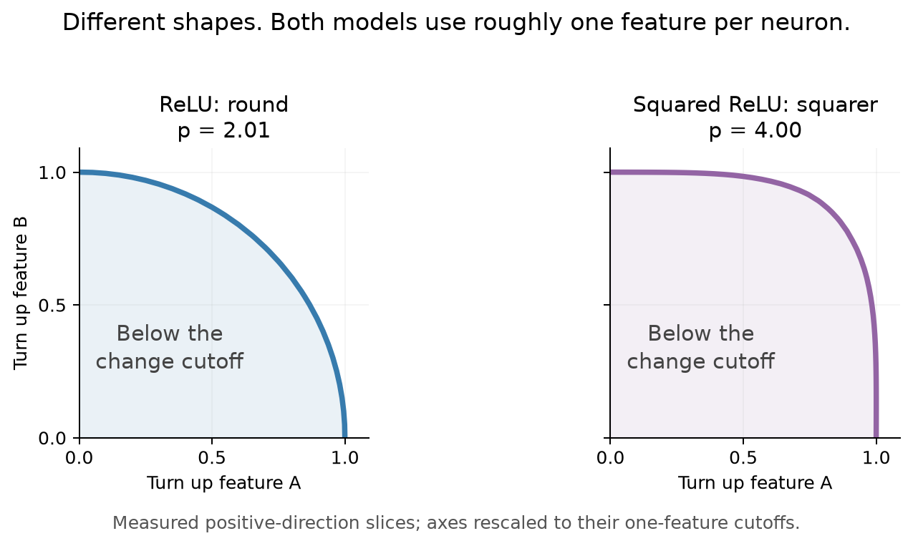

# qwench

Imagine two knobs inside a neural network. We turn them separately and together,
then draw a boundary where the network's response changes by a chosen amount.
Sometimes that boundary is round. Sometimes it looks more like a square.

**Does the shape reveal that the network is correcting mistakes? Or can simple
neurons make the same shape?** We explore this with Qwen language models and tiny
networks we can train and inspect.

The shape score, **p**, is 2 for a circle and larger for squarer shapes:



*Actual measurements from two separately trained toy networks, using the same
two features. Both learned roughly one feature per neuron. Only positive
perturbations are shown; the axes are rescaled to compare shapes.*

## What we've found

- **Toy networks:** we trained 120 tiny networks. Learning to clean up noise often
  made their boundaries squarer, but similar shapes could hide different repair
  ability. Turning other features on also changed the shape. **p describes the
  boundary; it isn't a repair score.**
  [Full report](reports/toy-characterization-study-v1/findings.md) ·
  [Earlier neuron-sharing test](reports/toy-scalar-comparison-v1/findings.md).
- **Qwen3-1.7B:** fixing an anchor-sampling mismatch recovered a strong paper
  result: p = 2.442 versus 2.415. [Sampler audit](reports/implementation-audit-v1/findings.md).
- **Qwen3.5-4B:** results are exploratory; the comparison using historical
  anchors is still pending. [Findings](reports/stress-4b-v1/findings.md).

## Try it

Python **3.12**, CPU only. These commands rebuild saved toy figures; no model
downloads or training:

```bash
git clone https://github.com/bubskee/qwench.git
cd qwench
python3.12 -m venv .venv
.venv/bin/python -m pip install -r requirements/figures.txt
.venv/bin/python scripts/reproduce.py verify
.venv/bin/python scripts/reproduce.py toy-figures
```

Plots appear in `work/reproductions/toy-figures/`.
[Reproduction guide](docs/reproduction.md): refitting, the README visual, and full retraining.
[Experiment index](docs/experiments.md): everything else.

Starting point: Ferreira da Silva & Heimersheim,
[*Evidence for Feature-Specific Error Correction in LLMs*](https://arxiv.org/abs/2606.24964).
