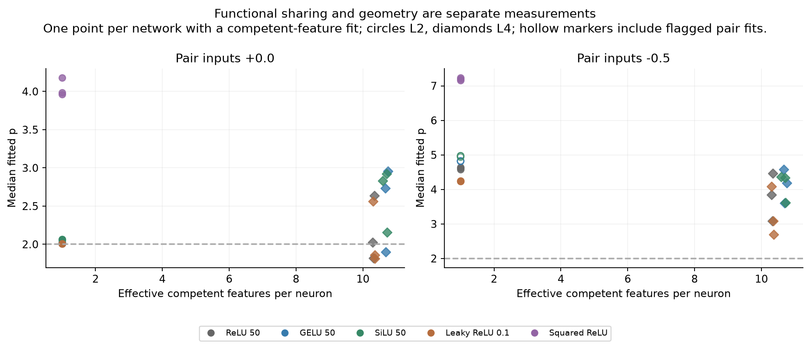

# qwench

Small experiments on feature-specific perturbation geometry in Qwen3-1.7B,
Qwen3.5-4B, and trained toy networks, following
[Ferreira da Silva & Heimersheim](https://arxiv.org/abs/2606.24964).

The question: when a perturbation boundary looks square, what have we learned
about the computation inside? A superellipse exponent **p > 2** can indicate
privileged feature geometry. It does not, by itself, establish error correction.

## Reproduce the toy figures

From a fresh clone, with Python **3.12** and a CPU:

```bash
git clone https://github.com/bubskee/qwench.git
cd qwench
python3.12 -m venv .venv
.venv/bin/python -m pip install -r requirements/figures.txt
.venv/bin/python scripts/reproduce.py verify
.venv/bin/python scripts/reproduce.py toy-figures
```

The five rebuilt plots and a numerical comparison receipt appear in
`work/reproductions/toy-figures/`. This route uses saved fits; it needs no PyTorch,
LLM weights, or training. `verify` checks saved toy artifacts against SHA-256
manifests. It does not rerun the numerical audit.

To **refit every saved toy response grid** before plotting:

```bash
.venv/bin/python scripts/reproduce.py toy-refit
```

Outputs go to `work/reproductions/toy-refit/`. Both commands check regenerated
numerical summaries against the committed results. Existing output directories
are protected; use `--out work/reproductions/another-run` for another attempt.
The [reproduction guide](docs/reproduction.md) covers full retraining, the cached
paper figure, dependencies, hardware, and resume behavior. `make help` lists
shortcuts to the same commands.

## What we found

We trained **30 toy networks**: five activations × two losses × three
initialization seeds, each for 100,000 updates. Each has 100 sparse input features
and 50 hidden neurons; matching runs share data, minibatches, and starting
matrices. Each activation learns its own weights.



*Each point is one trained network. Circles use L2 loss; diamonds use L4.
Hollow points include flagged pair fits. Colors identify activations.*

L2 models learned 50 features accurately with roughly one feature per neuron.
Under L4, ReLU, GELU, SiLU, and Leaky ReLU learned all 100 through shared neurons.
GELU and SiLU had higher average p under L4, with similar measured sharing and
overlapping seed ranges.

The fun part: **squared ReLU reached p = 4.04 under L2 while remaining
specialized**, versus 2.15 for matched random directions. A larger exponent
therefore does not reliably mean more sharing. Its L4 models learned less
accurately and missed the declared competence cutoff. This fixed task and
training recipe do not establish a general activation ranking or a grokking
result. [Toy findings and methods](reports/toy-scalar-comparison-v1/findings.md).

The LLM sampler audit recovers the strong 1.7B positive case: **p = 2.442 versus
published 2.415**. Our first attempt used different anchors because streaming
shuffle behavior changed between `datasets` versions. The historical-anchor 4B
comparison remains pending; existing 4B results are exploratory.

## Navigate the experiments

| Experiment | Read this | Reproduction route |
|---|---|---|
| Trained toy activations | [Findings](reports/toy-scalar-comparison-v1/findings.md) | `toy-figures`, `toy-refit`, `toy-train` |
| Cached paper Figure 2 | [Fit receipt](reports/paper/reproduction.json) | `paper` |
| 1.7B sampler audit | [Findings](reports/implementation-audit-v1/findings.md) | [Audit methods](reports/implementation-audit-v1/METHODS.md) |
| Exploratory 4B stress test | [Findings](reports/stress-4b-v1/findings.md) | [Experiment index](docs/experiments.md) |
| Released-checkpoint toy pilot | [Findings](reports/toy-cis-v1/findings.md) | [Pilot protocol](docs/toy-cis-pilot-v1.md) |

`scripts/` holds runners and analyses; `configs/` holds frozen protocols;
`reports/` holds committed evidence; `work/` holds ignored reproduction outputs.
Original source paths remain stable because the reports seal their hashes.
See the [full experiment index and repository map](docs/experiments.md) for
earlier checks, input locations, and archived runs.
