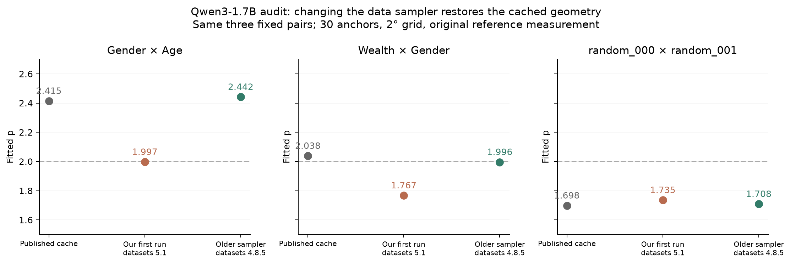

# The 1.7B reproduction miss came mainly from the sampler

**The strong positive case returns after recovering the older anchor sampler.**
Our first run copied the released seed and buffer settings but used `datasets`
5.1, whose streaming shuffle differs from the pre-paper implementation. All
30 selected documents changed. This was an input mismatch in our reproduction.

| Pair | Published cached p | Our first run, datasets 5.1 | Recovered sampler, datasets 4.8.5 |
|---|---:|---:|---:|
| Gender × Age | 2.415 | 1.997 | **2.442** |
| Wealth × Gender | 2.038 | 1.767 | **1.996** |
| Fixed isotropic pair | 1.698 | 1.735 | **1.708** |

These are point estimates, not new confidence intervals. The recovered run uses
the same three previously selected pairs, released direction vectors, 30
anchors, 2° grid, original clean single-example reference, and unmodified
reference sweep functions. No new pairs, layers, thresholds, or 4B runs were
introduced. The three recovered surfaces took 4.12 minutes of inference.

## Why the seed did not reproduce the anchors

The original recipe uses streamed FineWeb-Edu sample-10BT, seed 42, and a
10,000-example shuffle buffer. The public requirements do not pin `datasets`.
Version 4.8.5 yields a random buffered example and replaces it with the next
input. Version 5.1 instead emits half of a permuted buffer and also changes the
default shard interleaving. The same seed therefore operates on a different
sampling procedure. See the [upstream old implementation](https://github.com/huggingface/datasets/blob/4.8.5/src/datasets/iterable_dataset.py)
and [new implementation](https://github.com/huggingface/datasets/blob/5.1.0/src/datasets/iterable_dataset.py).

We tested one pre-paper version, 4.8.5, before inspecting corrected exponents;
we did not search dependency versions for a positive result. The 14 source
parquet objects are identical across the checked FineWeb release tags. The
model checkpoint, native inference runtime, and fitter remain fixed.

## How closely did we recover the inputs?

We did **not** find the original token cache in the public release, its 26
reachable commits/three branches, arXiv source, or the other public locations
checked. However, reconstruction gives strong evidence of the same ordered
anchors:

- Average block-2 activation norm: **31.85416**, versus released **31.86121**
  (0.022% difference). Our first sample gave **30.66250**.
- For **each of the three pairs**, every original anchor's full 31×31 response
  grid has its nearest recovered match at the **same index: 30/30**.
- All 90 corresponding response-grid correlations exceed **0.99679**.
- Mean absolute grid differences divided by the original mean response are
  **0.87%, 0.97%, and 1.29%**, respectively. Individual cells differ more;
  maximum differences and all correlations are retained in the machine summary.

This is much stronger than merely obtaining a similar fitted p. It supports
historical input recovery but is not a cryptographic verification of the
unavailable original token IDs. The exact historical package version remains
unknown. [Recovered windows and tokens](legacy-anchor-windows.tsv) ·
[Full sources, token IDs, and hashes](legacy-anchors.json).

## Did our implementation change the measurement?

The direct A/A audit finds no consequential translation error:

| Check | Result |
|---|---|
| Original hidden-state extraction vs saved block-2 prefixes, all 30 anchors | Exact match |
| Original final-token hidden state vs block-26 hook, all 30 anchors | Exact match |
| Actual original suffix vs native replay, identical inputs, batches 1/8/64 | Exact match |
| Original sweep with our first anchors and fresh vectors | p = 1.99647, versus our 1.99652 |
| Original sweep with our first anchors and released vectors | p = 2.00495 |
| Recovered anchors, same original functions and released vectors | p = 2.44165 |

The last two rows hold the implementation and vectors fixed while changing the
anchors. That isolates the large recovery to input sampling. Our point-builder
operation order changes 98 of 1,968,128 BF16 components in the checked grid;
its effect on this fitted p is about 0.000055. Layer indexing, last-token
selection, axis order, suffix behavior, threshold rule, and fitting procedure
are consistent with the reference.

The remaining p differences from the cache are +0.027, −0.042, and +0.010.
We have not reconstructed the authors' full runtime/hardware environment or
assigned these residuals to a single numerical cause. Wealth×Gender remains
approximately quadratic and crosses 2 between implementations; this weak
individual case should not receive a binary positive/negative label.

## What this changes

The earlier v1 miss should not be interpreted as failure of the original strong
1.7B positive case. The corrected small audit closely recovers the published
response patterns. The old 1.7B/4B results remain valid measurements on their
saved, different anchors; they do not constitute a historical-anchor transfer.
We have added a correction to that report without changing its computational
artifacts, and added a version guard to its anchor reconstruction script.

This establishes a procedural positive control, not the paper's full feature
versus random distribution or an error-correction mechanism. It also leaves
anchor sensitivity as a real generalization question: changing a sample can
materially change a 30-anchor aggregate. The next historical-anchor 4B comparison
can now use the recovered saved inputs instead of silently reshuffling them.

[Detailed methods and reproduction](METHODS.md) · [Fit and response comparisons](fit-summary.json) ·
[Execution audit](execution-audit.json) · [Artifact checks](quality-audit.json).
All five audit surfaces are complete: two implementation A/A surfaces and three
recovered-anchor surfaces, totaling 144,150 perturbation cases. Artifact checks
confirm all 59 frozen v1 computational files are unchanged.
