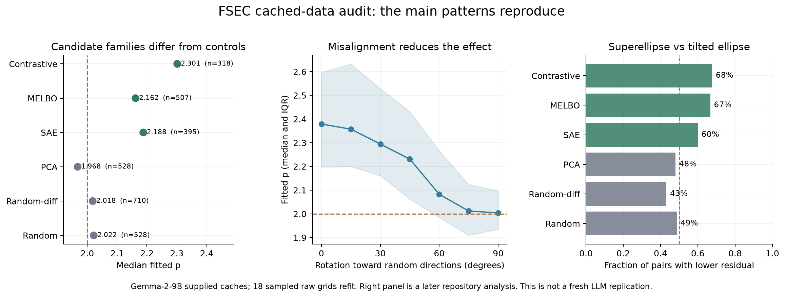

# FSEC reproduction audit

2026-11-01. Reference commit: `a9355d4001500708a40a255bacfe559e6dc269c0`.
The main numerical patterns reproduce from the supplied data. This is a
cached-data audit, not an independent regeneration of LLM activations.
The toy boundary was recomputed locally, using the released scalar settings.

## What we reran

| Result | Outcome | Artifact |
| --- | --- | --- |
| Figure 1 response curves, with 10 random directions | Reproduced; both feature axes exceed the random reference on at least 63% of the 30 anchors at every nonzero sampled angle | [Plot](figures/figure1_response.png) |
| Figure 2 Wealth × Gender boundary | Previously reproduced: p=2.40415, residual 1.219% | [Plot](../paper/paper-figure-2.png) |
| Figure 4 direction-family comparison | All six family means round to the reported values | [Current-repo plot](figures/figure4_families.png) |
| Figure 5 misalignment | Median p falls monotonically from 2.379 to 2.004 across seven rotation angles | [Plot](figures/figure5_rotation.png) |
| Figure 6 robustness | All reproduced subgroup means exceed 2; range 2.244–2.632 | [Plot](figures/figure6_ablations.png) |
| Appendix A direction overlap | 33 directions, 528 pairs, 318 admitted, 210 rejected | [Heatmap](figures/appendixA_overlap.png) |
| Appendix B fit residuals | All subgroup medians below 2%; largest is 1.881% | [Plot](figures/appendixB_residuals.png) |
| Toy misalignment, Figure 7 | Cached medians move from 3.034/3.080/3.332 toward 1.971/1.987/2.026 for 4×/8×/16× feature-to-neuron ratios | [Plot](figures/figure7_toy_rotation_cached.png) |
| Appendix C toy boundary | Fresh responses and fit give printed p=2.907 and residual 0.13%, matching reported rounded p=2.91 | [Plot](figures/appendixC_toy_boundary_recomputed.png) |

Figure 3's composition table contains literal example text in its plotting
code. Redrawing that table would not reproduce the model behavior, so it was
not counted as a successful behavioral reproduction.

For Figure 1, the raw crossing angles are Wealth 46.99°, Gender 38.47°,
equal mixture 45.48°, random reference 49.52°. A mixture need not outlast
both raw axes: the superellipse analysis first accounts for their different
sensitivities using axis normalization.

## Recomputing, rather than just redrawing

We selected three eligible pairs per family by label order (first, middle,
last), fetched their raw response grids, and recomputed their per-pair
thresholds and exact-geodesic point fits. All 18 agree with the saved
`p_point` values; the maximum absolute difference is **4.02e-9**. The sample
was not selected by exponent, but it is a numerical consistency check,
not an unbiased estimate of the family distributions. No raw-grid bootstrap
uncertainty was recomputed for this sample.

The full cached-family summaries are:

| Family | Eligible pairs | Mean p | Median p |
| --- | ---: | ---: | ---: |
| Contrastive | 318 | 2.42252 | 2.30125 |
| MELBO | 507 | 2.21166 | 2.16164 |
| SAE | 395 | 2.28116 | 2.18751 |
| PCA | 528 | 2.02638 | 1.96776 |
| Random activation differences, averaged | 710 | 2.04984 | 2.01807 |
| Isotropic random | 528 | 2.03267 | 2.02160 |

The original scripts reran their direction-level bootstrap plots from
these saved pair fits. This still does not validate the upstream model
loader, intervention implementation, prompt extraction, or LLM sweeps.

For the fresh toy check, the sparse weights were regenerated from seed 42,
then the responses were evaluated and the boundary fit on CPU. We reused
the released sparsity and gain settings; their scalar optimization was
not rerun. The figure script uses 120 mixing angles and 2,500 radii.
[Toy receipt](toy-boundary/receipt.json) records the command and hashes.

## Exceptions and exact-match limits

**The result is a distributional tendency.** In the supplied filtered
contrastive set, 39/318 pairs have p≤2. The lower-tail Era × Tense example
refits to p≈1.539 with only 0.70% radial residual. This is not merely a bad
superellipse fit. It was selected after seeing the distribution to
illustrate an exception, not as a representative pair.
[Negative-case plot](figures/negative-case-era-tense.png), [receipt](negative-case.json).

**Appendix B's exact caption counts do not match the current repository.**
The regenerated plot has 11,762 dots with one above its 12.5% clipping
limit; the arXiv v1 caption says 10,719 dots and four clipped. Its headline
low-median-residual claim reproduces. The exact population/count mismatch
remains a repository-versus-paper reconciliation issue; it was not silently
normalized away. The current family script also adds a seventh,
shuffled-weights column beyond the paper's six families.

**Some tails hit the fit bound.** One MELBO pair reaches the p≈10 upper
search limit. A large fitted p needs a boundary/fit-quality check, not
automatic interpretation as a feature.

One initial plotting failure was our incomplete sparse checkout: the
token-position loader needs `results/pos_pairs_gemma_L2.csv`. Fetching that
file restored all three position subgroups and the residual plot. This was
a missing input in our setup, not evidence against the paper's result.

## Where the authors identify possible failure

The [arXiv v1 appendices](https://arxiv.org/html/2606.24964v1#A1) cover
direction overlap (A), fit residuals (B), and the toy construction (C).
The overlap filter matters especially for related language directions.
The toy perturbations use inactive features around a fixed input, tied
weights, a tanh-cubed nonlinearity, and no fresh perturbation-time noise.

The sharper caveats are in
[Discussion and Future Work](https://arxiv.org/html/2606.24964v1#S6):
plateaus may reflect learned robustness or return toward a data manifold;
preliminary attempts to maximize p did not reliably find feature-like
directions. The authors explicitly leave broader toy activations and
architectures for later investigation. The preliminary optimization failure
is a reported caution, not something we reproduced from released data.

## Useful later repository additions

These are present at the pinned commit but are not in the inspected arXiv
v1 appendices.

**Tilted ellipses.** The repository fits the equally parameterized model
`x² + 2δxy + y² = 1` on the same contours. We recomputed this comparison
for the same 18 raw grids; the largest difference from its saved CSV is
**3.32e-13** across the four recorded fit quantities. The superellipse's
median residual on contrastive pairs is 1.136%, versus 1.279% for the
tilted ellipse, but the ellipse wins on **103/318** pairs. The advantage is
aggregate and modest. Shared directions also make a naive pair-level sign
test dependent. [Conic audit](conic-audit.json),
[original source](https://github.com/FranciscoHS/fsec-paper/blob/a9355d4001500708a40a255bacfe559e6dc269c0/scripts/fit_conic_comparison.py).

**Shuffled weights.** Reaggregation gives median p=2.00089 over 100
shuffled-model fits; applying each shuffled model's overlap filter leaves
74 fits with median 1.99582. The same 20 named pairs in the trained model
have median 2.05454, much lower than 2.30125 across all 318 filtered trained
pairs. The broad unmatched comparison and the small matched subset answer
different questions. We did not rerun the shuffled models.
[Author's note](https://github.com/FranciscoHS/fsec-paper/blob/a9355d4001500708a40a255bacfe559e6dc269c0/docs/shuffled_baseline_and_stats.md).

**J-lens directions.** Cached medians reproduce: contrastive 2.403,
Chinese J-lens 1.909, English J-lens 2.153 on Qwen3.6-27B. This is not a
universal high-p result for lens-derived directions. The J-lens sweeps use
20° windows versus 60° for contrastive directions, and the English set is
only ten pairs with a relaxed overlap cutoff. These are lens-derived
perturbation directions, not a test of R/J++ readouts observing contrastive
interventions. [Plot](figures/jlens_later_addition.png),
[setup](https://github.com/FranciscoHS/fsec-paper/blob/a9355d4001500708a40a255bacfe559e6dc269c0/jlens/README.md).

## Small next stress tests

These are proposals, not completed replications:

1. Fit each anchor separately, report crossing coverage, and compare that
   distribution with a fit to the median response surface. This tests how
   much aggregation affects the geometry.
2. Repeat a fixed direction pair on neutral and feature-active anchors,
   with both signs. Corpus ablations do not settle feature-activity effects.
3. Use the toy's active features, ordinary activations, or perturbation-time
   noise, with fair retuning of its scalar settings. The current positive
   toy result need not survive every change.
4. Compare against a simple coordinatewise nonlinear response. For example,
   `g(x,y)=(x²,y²)` has `||g(x,y)-g(0,0)||₂=√(x⁴+y⁴)`, hence a p=4 unit
   contour. This illustrates why a shape alone does not establish recovery
   of corrupted features; it does not refute the paper's empirical geometry.

Our previous output-steering gates were extra checks for our semantic lens
interpretation. They are not a prerequisite used to select all candidates
in this paper's geometry analysis. Failing those checks does not predict
that our Qwen directions would have p≈2; that measurement remains unrun.

## Reproduction files

`summary.json`, `raw-refits.json`, `conic-audit.json`, the input hash manifest,
original-script logs, and PNG/PDF artifacts are saved here. The audit's
exact executed source is `audit-source.py`. No new LLM weights were downloaded.
See the repository README for commands.
