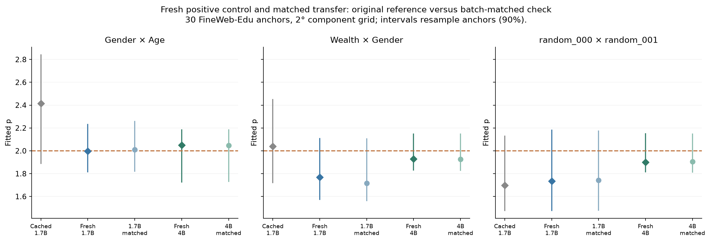
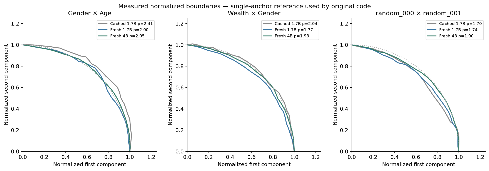

# Fresh 1.7B positive-control attempt and matched 4B comparison

All six prescribed surfaces completed: **172,980 fresh perturbation cases**,
30 anchors per surface, and a 31×31 grid with 2° component spacing. Summed
surface time was 47.4 minutes. Two L2 reference measurements come from
each perturbed output; this does not double the number of independent cases.

**We did not cleanly recover the saved 1.7B feature point estimates. The two
fresh models show no clear difference on these fixed feature cases.** That
limits any claim that our earlier result was a failure specific to 4B.

| Pair | Original cached 1.7B | Fresh 1.7B | Fresh 4B |
|---|---:|---:|---:|
| Gender × Age | 2.415 | 1.997 | 2.049 |
| Wealth × Gender | 2.038 | 1.767 | 1.929 |
| Fixed isotropic pair | 1.698 | 1.735 | 1.900 |

These are the original single-clean-anchor reference measurements. The
complete comparison, including batch-matched numerical checks, is below.

The intended positive case, Gender × Age, changes from 2.415 in the saved
1.7B data to 1.997 in the fresh run. Wealth × Gender changes from 2.038 to
1.767. The fixed random pair is closer: 1.698 versus 1.735. However, 3/3
fresh 1.7B point estimates fall within the original data’s 90% anchor-bootstrap
intervals. For Gender × Age that original interval is [1.89, 2.84]. We have
neither exact point reproduction nor a decisive statistical contradiction.
This positive-control attempt is therefore inconclusive as confirmation of
strong privileged geometry.

For the fresh model comparison, the same 30 source documents are paired:

| Pair | 4B − 1.7B p | 90% paired-anchor interval |
|---|---:|---:|
| Gender × Age | 0.052 | [-0.347, 0.245] |
| Wealth × Gender | 0.161 | [-0.152, 0.449] |
| Fixed isotropic pair | 0.165 | [-0.215, 0.511] |

Intervals use 500 shared source-document resamples, recalibrating the
threshold in each draw. They describe these fixed cases, not populations
of models or latent features. An interval spanning zero is not evidence
of model equivalence. There are only two feature pairs and one random pair.
The random pair was mechanically the first released seed-42 pair; its saved
p=1.698 is below the released 17-pair control median of 1.999. It is not a
representative estimate of that distribution.

The experiment matches the released recipe: exact contrastive prompts,
single-prompt direction extraction, unit mean(B−A), block output 2 perturbed,
penultimate block measured (26/30), norm-preserving geodesic interventions,
median response across 30 five-token anchors, pair-specific threshold, and
the original exact-sine superellipse fitter. All three proposed pairs pass
the same cosine cutoff on both models. Inputs, direction vectors, and pair
eligibility were committed before fresh full-surface fits. No pairs, layers,
or thresholds were changed to recover a positive result.

The dataset is specifically FineWeb-Edu, sample-10BT, with the released
seed-42 shuffle recipe and 10,000-document buffer. **The original historical
token cache is unavailable.** We regenerate and pin the recipe; we cannot
verify that these are the authors’ historical 30 inputs. Both fresh models
use the same documents, with their own five-token encodings; decoded windows
agree in 29/30 cases and differ at a newline boundary in one. The old runtime
and checkpoint revisions were also not pinned in the release. Cached-versus-
fresh differences therefore cannot be attributed solely to model behavior.

Numerical fidelity checks are reassuring. Fresh 1.7B directions match the
released vectors with cosines above 0.99998. The original manually iterated
1.7B suffix and native replay agree exactly on clean and perturbed inputs at
batches 1 and 8. Stopped/full captures and fixed-prefix/native clean passes
also agree exactly. Every batch-matched zero-angle response is zero; maximum
relative norm error is 0.140%. There are 0/6 flagged primary fits.

The predeclared reference-mode check gives:

| Pair | 1.7B: single / matched reference | 4B: single / matched reference |
|---|---:|---:|
| Gender × Age | 1.997 / 2.011 | 2.049 / 2.048 |
| Wealth × Gender | 1.767 / 1.717 | 1.929 / 1.926 |
| Fixed isotropic pair | 1.735 / 1.742 | 1.900 / 1.905 |

The original single-reference mode can have a BF16 batch-shape floor, which
we preserve and record. The matched mode removes that origin floor. For the
feature pairs, this adjustment does not recover the higher old 1.7B point
estimates. It is a sensitivity check, not an outcome-selected replacement.

We stop at the six surfaces. R/J++ observations remain separate. A stricter
historical reproduction would require the original token IDs and runtime
provenance; a broader feature-specificity claim would require a larger
prespecified feature/control cohort. These results do not establish absence
of error correction or any selective reporting by the authors.

[Methods and protocol history](METHODS.md) · [CSV](analysis/results.csv) ·
[Complete analysis](analysis/summary.json) · [Quality audit](analysis/quality-audit.json).
Raw two-channel surfaces and receipts are in the two model directories.
The saved inputs and response arrays suffice to regenerate plots without
loading model weights or streaming FineWeb again; see the repository README.
