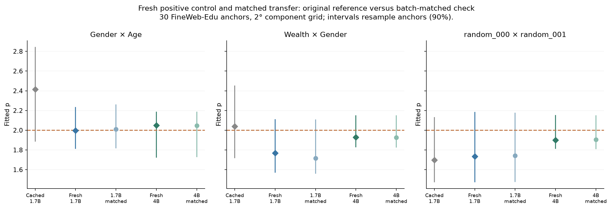

# Fresh 1.7B control and matched 4B comparison

**Sampler correction:** The follow-up [implementation audit](../implementation-audit-v1/findings.md) found that `datasets` 5.1 changed the streaming shuffle. These frozen v1 runs used different anchors from the paper. Regeneration with the pre-paper sampler recovers the original response patterns and the strong Gender×Age positive case. The figures and numbers below describe the original attempt, retained for transparency.

**The intended 1.7B positive control was inconclusive; these fixed cases do
not show a clear difference between the fresh models.** The saved 1.7B feature
point estimates were not cleanly recovered, so this does not isolate a failure
specific to 4B.

We completed all six prescribed surfaces: two contrastive pairs and one fixed
isotropic pair per model, **30 shared FineWeb-Edu source documents, a 2° grid,
and 172,980 fresh perturbation cases**. Summed surface time was 47.4 minutes.

| Pair | Original cached 1.7B | Fresh 1.7B | Fresh 4B |
|---|---:|---:|---:|
| Gender × Age | 2.415 | 1.997 | 2.049 |
| Wealth × Gender | 2.038 | 1.767 | 1.929 |
| Fixed isotropic pair | 1.698 | 1.735 | 1.900 |

These use the original single-clean-anchor reference measurement.

All four fresh feature estimates have 90% anchor-bootstrap intervals that
include 2. All three fresh 1.7B point estimates also fall inside the original
surfaces’ broad anchor-bootstrap intervals; the original Gender × Age interval
is [1.89, 2.84]. Thus we have neither exact point reproduction nor a decisive
statistical contradiction of the saved measurements.

The fresh 4B minus fresh 1.7B differences are:

| Pair | Difference in p | 90% paired-anchor interval |
|---|---:|---:|
| Gender × Age | 0.052 | [−0.347, 0.245] |
| Wealth × Gender | 0.161 | [−0.152, 0.449] |
| Fixed isotropic pair | 0.165 | [−0.215, 0.511] |

These use 500 shared source-document resamples with threshold recalibration.
Intervals spanning zero do not establish model equivalence. Two feature pairs
and one control cannot reproduce the paper’s distributional claim. In
particular, the mechanically selected first random pair was already below 2
in the old data; the original 17-pair isotropic-control median was 1.999.

Numerical fidelity checks pass. Fresh 1.7B directions match released vectors
with cosines above 0.99998; the original suffix calculation and native replay
agree exactly on clean and perturbed inputs. All six primary fits are clean,
with mean radial residual below 1.13%. Batch-matched zero-angle responses are
exactly zero, and maximum relative norm error is 0.140%. The predeclared
batch-matched reference check changes the feature p values by at most 0.051;
it does not recover the higher saved 1.7B estimates.

**Historical input identity remains unverified.** We regenerated the released
FineWeb-Edu sample-10BT, seed-42, 10,000-buffer recipe; the original token cache
is unavailable. Both fresh models use the same documents, with native
five-token encodings agreeing in 29/30 decoded windows. We pinned current
model/data revisions and runtime packages, which the old release did not.
Old-versus-fresh differences therefore cannot be assigned solely to model
behavior. The matched fresh-model comparison is better controlled.

We stop at the six surfaces. No pairs or layers were changed to recover a
positive result; R/J++ readouts remain separate. The useful outcome is a
reproducible limit on the earlier interpretation: this is not evidence that
the paper’s effect reproduces cleanly on 1.7B and then fails uniquely on 4B.
A strict historical reproduction needs the original token IDs and runtime
provenance; a broad feature-specificity test needs a larger prespecified cohort.

[Methods and protocol history](METHODS.md) · [Detailed analysis](analysis-notes.md) ·
[Normalized contours](analysis/contours.png) · [CSV](analysis/results.csv) ·
[Machine summary](analysis/summary.json) · [Quality audit](analysis/quality-audit.json).
Saved inputs and response arrays support plot regeneration without loading
model weights or streaming FineWeb again. See the repository README.
