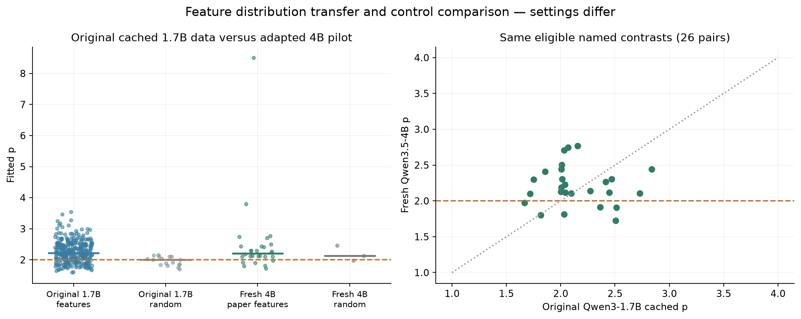

# Qwen3-1.7B reference comparison

Follow-up: [the fresh 1.7B / 4B matched run is now complete](../positive-control-v1/findings.md).
The intended positive control did not cleanly recover the old feature point
estimates, and paired fresh-model intervals span zero. The cached-data
comparison below should be read alongside that result.

The paper includes **Qwen3-1.7B**, alongside Gemma-2-9B, Llama-3.1-8B,
Mistral-7B-v0.3, Aya-Expanse-8B, and Yi-1.5-9B. There is no 3–4B model in
the main six-model experiment. The loader also supports Qwen3-4B, but that
alias is not evidence of a reported 4B experiment.

We compared the original 1.7B fit cache and independently refitted all 17
available matching isotropic-control raw sweeps. **No fresh 1.7B model
forwards were performed.** The standard local Hugging Face cache does not
contain Qwen3-1.7B weights.

| Cohort | Pairs | Median p | Fraction p > 2 |
|---|---:|---:|---:|
| Paper’s Qwen3-1.7B feature column | 310 | 2.226 | 78.4% |
| Original 1.7B isotropic controls, raw refits | 17 | 1.999 | 47.1% |
| Our fresh Qwen3.5-4B paper contrasts | 28 | 2.208 | 78.6% |
| Our fresh 4B isotropic controls | 3 | 2.131 | 66.7% |
| Same 26 eligible names: original 1.7B | 26 | 2.040 | 80.8% |
| Same 26 eligible names: fresh 4B | 26 | 2.163 | 76.9% |

The full feature distributions have similar medians and fractions above 2.
The small 4B control cohort sits higher. But matching the feature names also
weakens the original 1.7B cohort: its median falls to 2.040. The matched
feature-minus-isotropic-median gaps are therefore approximately 0.041 on
1.7B and 0.031 on 4B. These are descriptive, conditional comparisons, not
independent-population estimates or controlled model effects.

A binary p > 2 count is especially easy to overinterpret: almost half the
original near-quadratic controls are just above 2, as one might expect from
variation around 2. The distribution and separation matter more than that
cutoff. The prior 4B result remains a valid stress-test observation, but it
should not be described as a clean failure to reproduce the paper.

| Setting | Original 1.7B | Our 4B pilot |
|---|---|---|
| Checkpoint | Qwen/Qwen3-1.7B | Qwen/Qwen3.5-4B |
| Perturb → measurement block | 2 → 26, penultimate | 2 → 30, penultimate |
| Anchors | 30 FineWeb, seed 42 | 8 DCLM, seed 20261101 |
| Grid | 0–60°, 2° steps, 31×31 | 0–60°, 5° steps, 13×13 |
| Candidate pairs | Broad original cohort | Fixed challenges + seeded strata + coverage |
| Isotropic controls | 17 raw files available | 3 accepted fixed-seed pairs |
| Shared measurement rules | Geodesic, median response, per-pair threshold, exact sine normalization | Same |

A stronger next experiment is a **fresh positive-control run on Qwen3-1.7B**
using the original FineWeb sampling, 30 anchors, 2° grid, exact contrastive
prompts, and preselected feature/control pairs. Run that same pipeline on
Qwen3.5-4B, changing only the model and its penultimate-layer index. This
separates pipeline fidelity from model generalization. A same-size Qwen3-4B
would be a useful later bridge, but is not the paper’s tested small model.
The original loader does not pin a checkpoint revision; a fresh run should
pin the checkpoint and dataset revisions and disclose that historical
bit-for-bit identity is not established.

Two implementation details are retained for faithful interpretation. First,
the original model-column plotting path applies each model’s overlap cutoff
and then the target Gemma cutoff; this produces the 310-pair Qwen column.
Qwen-only overlap filtering gives 326 pairs, median 2.217 and 78.8% above 2,
so that detail has little effect on the headline comparison. Historical
ordered-pair duplicates are collapsed with the original last-entry-wins rule.
The 26-pair intersection above uses the Qwen-only cutoff.

Second, the original raw control files have nonzero zero-angle responses
(maximum 68.15 in their activation units). We preserve and report these;
no floor correction is applied. Our 4B forwards instead use batch-size-matched
clean baselines and have exactly zero origin response. This is another reason
to validate a fresh exact-model positive control before attributing differences
to model identity. This cached comparison covers isotropic controls; it does
not supply a Qwen-specific matched random-activation-difference experiment.

[Machine-readable comparison](comparison.json) records all original control
refits, hashes, eligible pairs, and caveats. Source revision:
`a9355d4001500708a40a255bacfe559e6dc269c0`.
Paper: [Evidence for feature-specific error correction in LLMs](https://arxiv.org/html/2606.24964v1).
