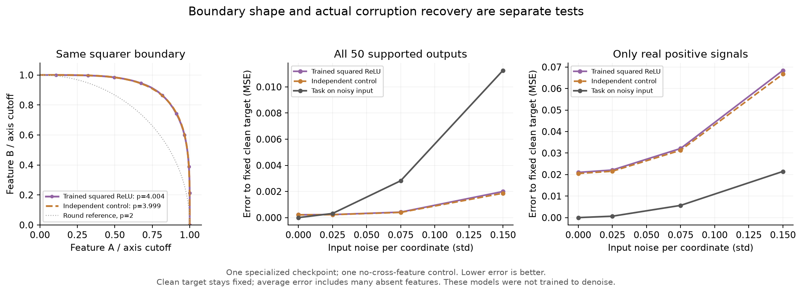

# The independent squared-ReLU control has the same geometry

**A no-cross-feature control reproduces the trained model's p≈4 boundary and
does at least as well on this fixed-target corruption probe.** Both reduce
noise on absent features; neither shows a signal-recovery advantage over simply
applying the task to the noisy input. This is one specialized checkpoint, not a
test of a model trained to denoise or a refutation of FSEC in LLMs.

## What was matched?

We used the existing `relu2_50_L2_s0` network: 100 inputs/outputs, 50 hidden
neurons, 50 competent features, roughly one competent feature per neuron.
The control has the same width, squared-ReLU activation, supported feature set,
encoder-column lengths, and isolated positive-feature self-responses. It puts
each supported feature in a separate neuron, with all other connections zero.

It cannot use one feature to repair another. It **can** clip/square away some
noise. Calling it a control without cross-feature correction is more precise
than claiming it can never denoise. Full clean outputs, negative rays, pair
overlap, and the number of free connections are not exactly matched.

## Geometry

One previously selected pair (10, 65), four frozen backgrounds, positive
perturbations, and the same per-pair threshold give:

| Starting pair inputs | Trained p | Independent control p |
|---|---:|---:|
| Absent: 0 | 4.004 | 3.999 |
| Positive: +0.5 | 2.896 | 2.895 |
| Negative: −0.5 | 7.240 | 7.224 |

All six primary feature-direction fits are unflagged. **Even p>4 occurs in the
independent control**, so replacing a universal cutoff of 2 with 4 would not
identify a correction mechanism. [Operating-point plot](operating-point.png).
All six prespecified random-direction fits exceed the 2% residual flag; they
remain saved and are unsuitable for a clean feature/random exponent comparison.

## Actual corruption, fixed clean answers

We generated 2,048 sparse signed inputs and four paired Gaussian-noise draws
per input. The target remains **ReLU(clean input)**. Errors use the same 50
supported outputs; full 100-output scores are also retained. The reference
applies ReLU to the noisy input, treating corruption as if it were signal.

At the prespecified middle noise level, coordinate std 0.075:

| Method | MSE, all supported outputs | MSE, real positive signals |
|---|---:|---:|
| Task on noisy input | 0.0028184 | 0.0056653 |
| Trained squared ReLU | 0.0004188 | 0.0321375 |
| Independent control | 0.0003974 | 0.0313008 |

The average looks good because most features are absent. Both squared-ReLU
models strongly suppress their noise, while doing worse on genuine signals.
Some signal error already exists without noise: 0.02101 trained, 0.02050
control. Subtracting that clean error, added noise increases signal MSE by
0.01113 and 0.01080, versus 0.00567 for the input reference. The interpretation
therefore does not rest solely on a clean-task accuracy mismatch.

The trained-minus-control MSE difference is +0.0000214 overall and +0.000837
on positive signals. Example-block bootstrap intervals are respectively
[+0.0000169, +0.0000267] and [+0.000408, +0.001372]. These describe sampling
uncertainty conditional on this checkpoint and input/noise set, not training-seed
uncertainty. The control's slight advantage is not a general architecture claim.

A clean-anchor Jacobian oracle shares each model's clean output and derivative.
It is an ablation with privileged information. Natural nonlinearities reduce
signal error slightly relative to this oracle but create more absent-feature
error, worsening the overall score. There is no uniform recovery advantage.

## Checks and stopping point

Autograd verifies the oracle derivatives. The control has zero probe cross-talk,
its scalar formula independently reproduces the measured corruption scores,
and all saved error sums/counts pass audit. The first run hit a JSON serialization
bug; the original preparation and a source amendment are retained. Retried raw
geometry is byte-identical to the failed attempt. No settings or inputs changed.

The useful result is **matched scalar nonlinearities explain this geometric
signature; measured denoising does not require cross-feature computation here**.
These networks were trained on the original task, not Gaussian corruption. One
checkpoint, one pair, four noise levels: the declared tiny stopping rule is met.

[Methods/reproduction](METHODS.md) · [Numerical summary](numerical-summary.md) ·
[Quality audit](quality-audit.json) · [Protocol](../../configs/squared-recovery-v1.json)
