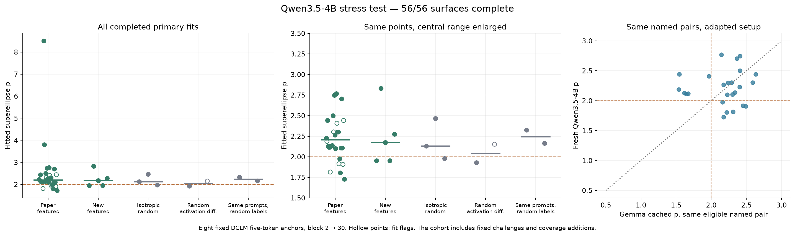
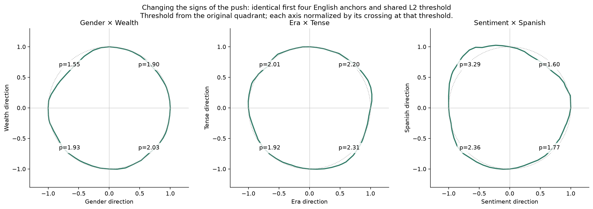

# Qwen3.5-4B stress test: geometry survives selectively; specificity is weak here

We completed the frozen fresh-model test: **37 candidate directions, 33 feature
pairs, seven accepted controls, 56 surfaces, and 74,896 response measurements**.
Twenty-five feature pairs have p > 2, but so do five of seven controls. The
feature/control median gap is only **0.035**.
This pilot does not show a clean feature-specific split. Strong individual
examples remain; it does not establish that feature-specific geometry or
error correction is absent from the model.

The directions include all 33 paper contrasts and four new candidates:
temperature, size, speed, and vertical position. Selection covered all 37
names before sweeping. The layer pair stayed at block outputs 2 → 30, with
norm-preserving last-token interventions, eight fixed five-token DCLM anchors,
a per-pair response threshold, and the original exact-geodesic fitter.
The [methods and adaptations](METHODS.md) specify the frozen protocol and
which additional analyses were added later.

| Cohort | Pairs | Median p | p > 2 | Fit flags |
|---|---:|---:|---:|---:|
| All feature pairs | 33 | 2.187 | 25/33 | 7 |
| Original paper contrasts | 28 | 2.208 | 22/28 | 7 |
| Pairs involving new concepts | 5 | 2.174 | 3/5 | 0 |
| Isotropic random | 3 | 2.131 | 2/3 | 0 |
| Random activation differences | 2 | 2.040 | 1/2 | 1 |
| Same prompts, scrambled labels | 2 | 2.245 | 2/2 | 0 |

All 40 primary fits are finite. Flags mean radial residual above 2% or an
exponent at its fitting bound; flagged fits remain in the headline table.
Removing flagged feature fits gives median p=2.201, so messy fits do not
explain the weak separation. The primary plot shows every point:

The 500 shared anchor resamples give a 90% interval of **[-0.061, 0.232]**
for the fixed-cohort median gap. This is anchor sensitivity, not a confidence
interval over models or independent features. Seven controls are too few to
claim equivalence. The separately seeded stratified subset has median
p=2.284 (12 pairs); its gap versus pooled controls is 0.132, with an anchor
interval [-0.004, 0.434]. The broader cohort also contains fixed challenges
and direction-coverage additions, so it is not an unbiased sample of all
possible feature pairs.

The two same-prompt controls are especially useful. Gender × Wealth gives
p=2.228 with the intended labels and 2.326 after balanced random relabeling.
Sentiment × Spanish gives 1.815 with the intended labels and 2.164 after
relabeling. Scrambling labels is not guaranteed to remove all real feature
content, but an elevated p does not verify the named distinction.
[Matched comparisons](analysis/same-prompt-control.png) retain each anchor.

There are successes worth keeping. C++ × German gives p=3.800 with 0.86%
radial residual; its anchor interval is [2.16, 4.49]. The largest exponent,
C++ × Portuguese at 8.508, is much less stable: its anchor interval is
[1.88, 9.06], and halving/doubling the threshold changes p to 3.21/2.38.
Rust × Wealth gives a clean lower result, p=1.804 with 1.63% residual, but
its anchor interval reaches 2.28. Individual low-p plots do not prove
reliably subquadratic geometry across prompts.

Selection matters before fitting. Of the 666 possible feature pairs, 484
pass the paper's raw |cosine| < 0.1 filter. **No language–language pair and
no code–code pair passes.** Size × Temperature and two proposed controls
also fail the cutoff and are retained as exclusions, without replacement.
Thus coverage of every feature name still leaves whole comparison families
untested. [The overlap matrix](analysis/eligibility.png) makes that visible.

Signs and contexts matter after fitting. On the same first four English
anchors, with the original quadrant's L2 threshold held fixed, Sentiment ×
Spanish ranges from **p=1.60 to 3.29** across quadrants; Gender × Wealth
ranges from 1.55 to 2.03. The first-four-anchor Gender × Wealth result is
1.90, versus 2.23 on all eight. Era × Tense goes from 2.19 on the English
anchors (a flagged fit) to 1.46 on the four Spanish/code anchors (a clean
fit); holding the original threshold fixed gives 1.50. These context changes
do not isolate feature activity from language and code. The shared-threshold
analysis was added after the first sign results; all underlying diagnostic
runs were selected beforehand.

The numerical checks completed successfully:

| Fixed diagnostic pair | Original, 5° BF16 | 2.5° BF16 | 5° FP32 |
|---|---:|---:|---:|
| Gender × Wealth | 2.228 | 2.132 | 2.226 |
| Isotropic random, seed 101 | 2.131 | 2.126 | 2.159 |

The finer-grid Gender × Wealth data, subsampled back to the original grid,
recover exactly the original p=2.228; using all fine-grid contour points
gives 2.132. This isolates contour resolution as a material issue for that
small gap. FP32 checks change forward arithmetic using the same checkpoint
weights and stored directions; they do not re-extract directions in FP32.
These checks concern the two preselected pairs, not every outlier.

Every zero-angle response is exactly zero. Maximum relative norm error is
0.185% (tolerance 0.5%); early-stop captures match full forwards
exactly in the preparation check. Shared-point response differences are
recorded rather than hidden. Synthetic p=1.5, 2, 2.5, and 3 boundaries recover
within 0.017 at both grid spacings. [The quality audit](analysis/quality-audit.json)
contains seals, checks, and numerical comparisons.

A tilted quadratic has lower radial residual than the superellipse for
10/33 feature pairs, including 8/26 unflagged pairs. This is a descriptive
same-contour comparison, not a mechanistic model-selection result. Nonlinear
sensitivity and cross-coupling remain alternatives to error correction.
The [raw sensitivity traces](analysis/response-traces.png) show what actually
changes with intervention size; the [complete contour gallery](analysis/all-contours.pdf)
keeps every primary attempt visible.

The model, corpus, anchor count, grid spacing, control-pool size, and architecture
differ from the original Gemma setting. Qwen block 2 also precedes its first
full-attention block. Same-named pair comparisons are descriptive transfers
under an adapted setup, not a controlled attribution to model identity.
The four new contrasts are candidate directions without demonstrated semantic
purity. Our earlier output-steering checks were separate; there was no
steering or lens gate used to curate this geometry cohort.

The evidence supports a narrower conclusion than either blanket replication
or blanket failure: the recipe often produces p > 2 on 4B, but that signature
alone does not reliably distinguish these named feature pairs from these
controls. There is no basis here to infer intentional or unintentional
cherry-picking by the authors. We have identified concrete sensitivities a
broader replication needs to report.

We stop at this completed cohort. R/J++ observations remain separate and
unmeasured here. The interesting next target is the sign/context dependence,
with fresh matched controls and finer sampling if we extend the pilot.

Raw surfaces and receipts are in `surfaces/`; every fit and sensitivity check
is in `analysis/`. [CSV results](analysis/primary-results.csv) and
[machine-readable summary](analysis/summary.json) support the numbers above.
Protocol/feature prompts were committed in `aa544d4`, the implementation in
`ac3925f`, and the prepared cohort in `bfd69e1`, before fitting fresh surfaces.
Model revision: `851bf6e806efd8d0a36b00ddf55e13ccb7b8cd0a`.
See the repository README for the offline sweep and analysis commands.
