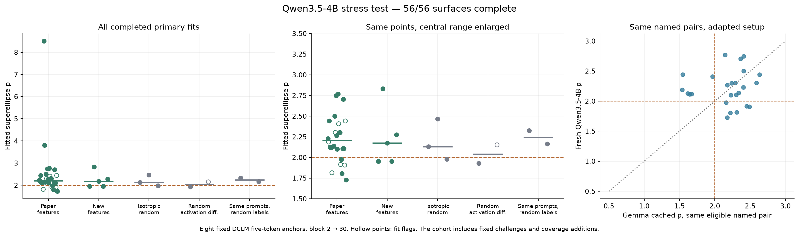
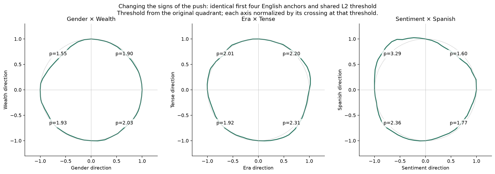

# Qwen3.5-4B: geometry often survives; specificity is weak here

The frozen fresh-model test is complete: **37 candidate directions, 33 feature
pairs, seven controls, 56 surfaces, and 74,896 response measurements**. We kept
block outputs 2 → 30 and eight fixed five-token English DCLM anchors, with
the paper’s norm-preserving interventions and exact-geodesic fitter. Pair
selection was committed before fitting the new surfaces.

**The clean feature/control split did not emerge in this pilot.** Twenty-five
of 33 feature pairs have p > 2, versus five of seven controls. Their medians
are **2.187 and 2.152**, a gap of only 0.035.

| Cohort | Pairs | Median p | p > 2 |
|---|---:|---:|---:|
| Original paper contrasts | 28 | 2.208 | 22/28 |
| Pairs involving new concepts | 5 | 2.174 | 3/5 |
| Isotropic random | 3 | 2.131 | 2/3 |
| Random activation differences | 2 | 2.040 | 1/2 |
| Same prompts, scrambled labels | 2 | 2.245 | 2/2 |

The fixed-cohort gap has a 90% shared-anchor bootstrap interval of
[-0.061, 0.232], using 500 resamples. The separately seeded stratified subset
has median p=2.284 (12 pairs); its control gap is 0.132, with interval
[-0.004, 0.434]. These intervals describe anchor sensitivity, not independent
features or populations of models. Seven controls are too few to claim
feature/control equivalence.

The same-prompt controls directly challenge the named-feature interpretation.
Gender × Wealth gives **2.228 with intended labels and 2.326 with scrambled
labels**. Sentiment × Spanish gives **1.815 and 2.164**, respectively.
Scrambled directions may still contain real features by accident, but an
elevated p does not verify the intended distinction.
[The matched-control plot](analysis/same-prompt-control.png) shows each anchor.

Strong examples survive. C++ × German gives **p=3.800**, with 0.86% radial
residual and anchor interval [2.16, 4.49]. C++ × Portuguese reaches 8.508 but
is unstable across anchors and thresholds. Rust × Wealth gives a clean
p=1.804, although its anchor interval still crosses 2. We retain all primary
fits, including seven flagged feature fits and one flagged control fit;
removing flagged feature fits changes their median only to 2.201.

Selection and context matter:

- The overlap filter accepts 484/666 possible pairs, but **zero language–language
  and zero code–code pairs**. Covering every feature name does not cover every
  comparison family. Exclusions were retained without replacement.
- On the same four English anchors and a shared L2 threshold,
  **Sentiment × Spanish ranges from p=1.60 to 3.29 across sign quadrants**.
- Era × Tense changes from 2.19 on English anchors to **1.46 on Spanish/code
  anchors**; holding the original threshold fixed gives 1.50. This does not
  isolate feature activity from language and code context.

The preselected numerical checks completed:

| Pair | 5° BF16 | 2.5° BF16 | 5° FP32 |
|---|---:|---:|---:|
| Gender × Wealth | 2.228 | 2.132 | 2.226 |
| Isotropic control, seed 101 | 2.131 | 2.126 | 2.159 |

The finer-grid feature/control gap is just 0.006. Subsampling the fine feature
surface back to the coarse grid recovers the original p exactly, identifying
contour resolution as material. All zero-angle responses are exactly zero;
maximum norm error is 0.185%. Synthetic known-p recovery and artifact checks
pass. These checks concern the two fixed pairs, not every outlier.

This is a transfer test of one direction-construction recipe on one additional
model and layer pair. Corpus, architecture, anchor count, grid spacing, and
control-pool size differ from the paper’s setting. The four new concepts are
candidate directions without established semantic purity. The results do not
establish absence of error correction or cherry-picking by the authors.
They identify concrete limits a broader replication should report. Nonlinear
sensitivity and cross-coupling remain alternative explanations for geometry.

We stop here. **R/J++ readouts remain separate and unmeasured.** The sign/context
dependence is the most interesting target if we extend the pilot.

[Methods and protocol history](METHODS.md) · [Detailed analysis](analysis-notes.md) ·
[All contours](analysis/all-contours.pdf) · [CSV results](analysis/primary-results.csv) ·
[Quality audit](analysis/quality-audit.json) · [Machine summary](analysis/summary.json)
