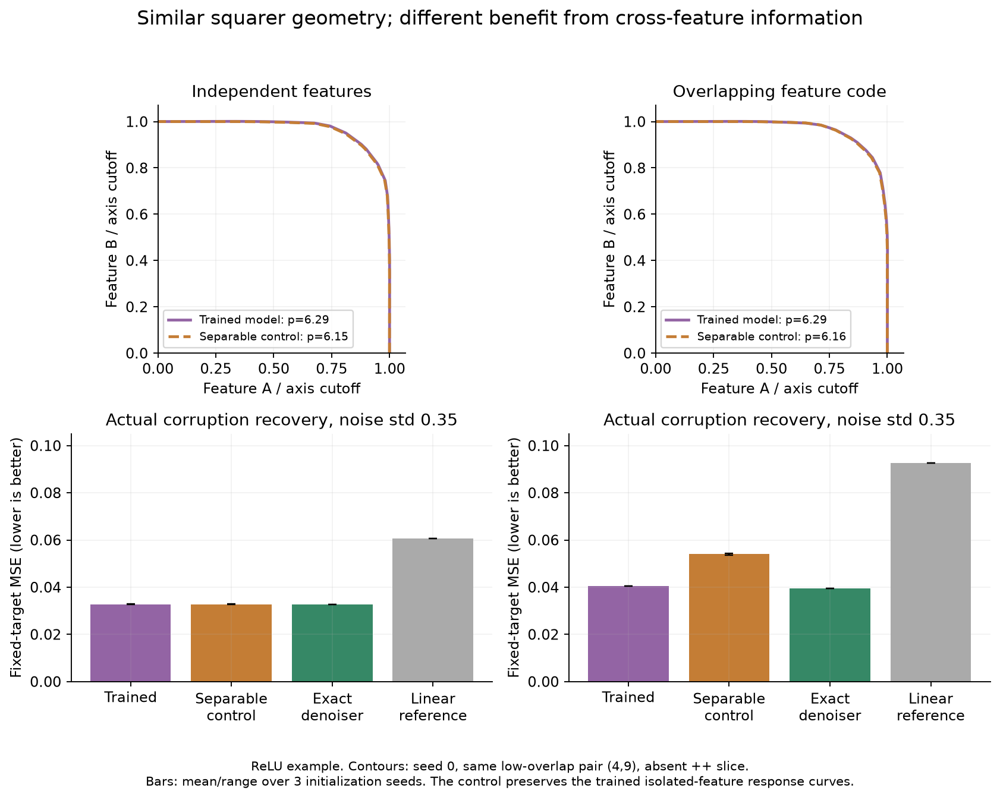
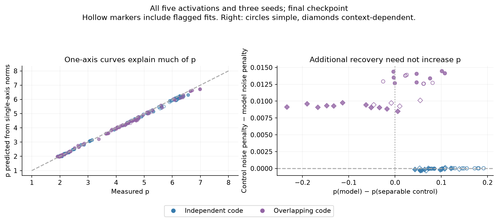

# What FSEC-style p tells us in these toy networks

**p tracks conditional nonlinear feature sensitivity, often the thresholds a
model learns for denoising. By itself, it does not calibrate the amount of
recovery, identify cross-feature inference, or establish computation in
superposition.** The measurement is useful; the mechanistic interpretation needs
additional controls and fixed-target tests.

Think of two knobs. The boundary describes what happens when we turn them.
Recovery asks a different question: after unwanted noise, did the answer get
closer to the original truth? These experiments produce examples where the
first measurement changes with the second, and examples where they separate.

## What we ran

We trained **120 new networks**, each for 100,000 updates, crossing:

- Five independently trained activations: ReLU, GELU, SiLU, Leaky ReLU, squared ReLU.
- A fixed decoder or a context cue that changes the decoder.
- Clean reconstruction or Gaussian-corruption training with fixed clean targets.
- Independent or overlapping feature directions.
- Three paired initialization seeds.

All use 33 inputs, 64 biased hidden units and 16 binary outputs. Six checkpoints
include initialization, 100, 1,000, 5,000, 20,000 and 100,000 updates. Another
**90 checkpoint frames from 30 existing bottleneck networks** keep the original
signed-sparse task separate. There are 810 network/checkpoint records in total.

The overlapping code has neighboring input directions with cosine 0.6. Its
Bayes-optimal denoiser genuinely uses neighboring decoded estimates. Both exact
posterior formulas were independently checked against all 65,536 possible clean
bit patterns. The main geometry probes still use low-overlap pairs.

## 1. Learning to denoise often makes the boundary squarer

With ReLU, clean reconstruction ends near p=2; noise training produces p around
4–6 on the inactive-feature slice. The other activations show the same broad
training-objective effect, with different values and some flagged fits.
Training longer alone does not make every model squarer. Squared ReLU also does
not impose p=4: learned biases and transfer curves matter.

[Geometry through training](training-geometry.png) ·
[Held-out recovery through training](training-recovery.png) ·
[All final activation/task summaries](numerical-summary.md).

Time here means checkpoints along one fixed cosine schedule, not separately
optimized training budgets. Every activation learned its own weights from
initialization. At the declared clean-competence cutoff, 108/120 final networks
pass all 16 features; the remaining partial failures stay in every summary.

## 2. Additional recovery does not require additional p

The **separable control** preserves each trained isolated-feature response curve,
including its activation and bias, but cannot condition an output on neighboring
latent estimates. It knows the true input coordinates. It may itself denoise;
calling it noncorrecting without that qualification would be misleading.

For a ReLU example, shared pair (4,9), mean over three seeds:

| Noise-trained task | Model p | Control p | Model MSE | Control MSE |
|---|---:|---:|---:|---:|
| Independent / simple decoder | 6.29 | 6.14 | 0.03271 | 0.03270 |
| Overlapping / simple decoder | 6.13 | 5.95 | 0.04046 | 0.05406 |
| Independent / context decoder | 4.97 | 4.85 | 0.03517 | 0.03482 |
| Overlapping / context decoder | 4.24 | 4.34 | 0.04369 | 0.05378 |

These feature fits are unflagged. MSE uses the original held-out corruption set,
all 16 outputs, and noise std 0.35. The p column describes one shared low-overlap
pair; the full summaries additionally retain the two prespecified pairs.

The overlapping models use cross-feature information to outperform the control,
including on positive bits. Yet the control can have similar or larger p.
Independent-model/control agreement is not a false positive for **feature
selectivity**: those models really learn featurewise denoising thresholds.
What does not follow is a particular internal mechanism or a CiS claim.

## 3. The one-dimensional responses explain much of the shape

A parameter-free null predicts the joint response from the measured single-axis
norms: `R_null(a,b)=sqrt(R(a,0)²+R(0,b)²)`, separately for each background.
For independent output changes scaling like a^k, this gives p≈2k without a
cross-feature mechanism. Learned transfer curves need not keep a fixed power.
For the 84/120 final denoising pair cases where both fits are unflagged, median
absolute p difference is **0.065**, with median full-grid response residual
**0.098%** of response range. The largest p difference is 0.262; this is an
approximation, not an identity for natural networks.

On directly coupled pairs, a stronger null matching the **entire** clean output
and both single-axis output-vector curves leaves substantial nonlinear
interaction: roughly 10–14% normalized residual, versus about 0.1–0.3% across
separate blocks. [Interaction plot](pair-interaction.png).

Those directly coupled directions have cosine 0.6 and fail the original paper's
pair filter. Their boundaries are often less square or poorly described by a
superellipse. The exact posterior denoiser shows the same structural issue:
its independent-code contour has p≈6.64, while its directly coupled contour is
irregular with a flagged nominal fit. This is a boundary of applying the assay,
not a paper-compatible counterexample. [Exact-denoiser contours](../toy-characterization-oracle-geometry-v1/boundaries.png).

## 4. Background state and the corruption law matter

A matched partner-activity intervention changes the same overlap-code ReLU
decoder from **p=6.16 to 2.90**, without retraining, on the same probed pair.
For the context decoder, the change is **4.38 to 2.34**. These fits are unflagged.
The original generic backgrounds have partners active in only one of four
cases, so a median can hide that conditional behavior.

This does not make p blind to interaction. Interaction can change the individual
feature response curves, and p changes with them. It does mean a single
anchor-averaged exponent is not a context-free property of a model.

A known-subspace projection also changes some clean-trained models' noisy-input
error substantially while leaving their entire tested feature-plane geometry
unchanged, verified to approximately 1e−14. Clean binary training constrains
codewords; the geometry probes interpolation/extrapolation between them, and
noise tests additional directions. Denoising training constrains those
neighborhoods more directly.

## 5. Fresh recovery validation survives the fairer controls

Fresh 4,096-example data, two new noise draws per example, and all final networks
confirm the result. After giving the natural model the same known-subspace
projection and clipping both predictions to [0,1], average MSE across the five
activation families and three seeds is:

| Noise-trained task | Projected/clipped model | Clipped separable control |
|---|---:|---:|
| Independent / simple | 0.03333 | 0.03334 |
| Independent / context | 0.03400 | 0.03380 |
| Overlapping / simple | 0.04004 | 0.05431 |
| Overlapping / context | 0.04150 | 0.05210 |

The overlapping-code benefit occurs in every activation family. It is not just
a clean-task bias gap: simple-decoder clean MSE was essentially matched
(0.004978 versus 0.004980) on the original test set.

**Lower average error does not mean preserving every active signal.** The sparse
prior favors conservative predictions. Even the exact denoiser has higher
positive-bit MSE than the clipped linear reference. On fresh overlapping/simple
data, active MSE is about 0.202 for the natural model, 0.230 for the separable
control, and 0.093 for the linear reference. The model improves on its matched
control in both strata, while retaining an absolute signal/noise tradeoff.

## Fit quality, checks and limits

Most fixed random-direction contours do **not** fit the superellipse ansatz
well: only 15/120 final denoising random pair fits are unflagged. We therefore
do not claim a clean reproduction of the paper's feature-versus-random split.
Only one seeded random pair is used; its nominal p values are not a population
baseline. Feature-fit flags and small axis reversals also remain visible.

All 25,920 primary surfaces and 100,827,200 response points, including fine checks, are complete.
There are 6,662 flagged fits, including 137 invalid fits, across all directions,
states, signs, checkpoints and controls. Eighty prespecified 61×61 checks change
p by at most 0.063. Gradients, Adam independence, exact checkpoint resume,
NumPy/MPS forward parity, exact posterior likelihood enumeration, null algebra,
raw error sums/counts, tables and fresh validation pass their checks.

The new networks have more hidden units than latent features. They are not a
test that forces CiS. The original bottleneck task is a separate historical
track, not pooled evidence for an activation ranking. These additive input-plane
toy measurements are not the paper's norm-preserving LLM residual intervention.
Three paired initialization seeds and two fixed probe pairs do not establish
population-level laws. Primary protocols and later exploratory diagnostics are
distinguished in the [methods](METHODS.md).

Our practical reading: use p to describe **conditional feature geometry**.
For mechanism claims, add axis-response controls, per-background/activity checks,
fit-quality reporting, and actual fixed-target recovery with signal scores.
The [paper](https://arxiv.org/abs/2606.24964) already separates its geometric
finding from alternative interpretations; this study makes that distinction
concrete on inspectable toy networks.

[Methods/reproduction](METHODS.md) · [All network frames](networks.csv) ·
[Seed summaries](seed-summary.json) · [Fit quality](fit-quality.json) ·
[Combined audit](quality-audit.json) · [Historical trajectories](historical-trajectories.png)
