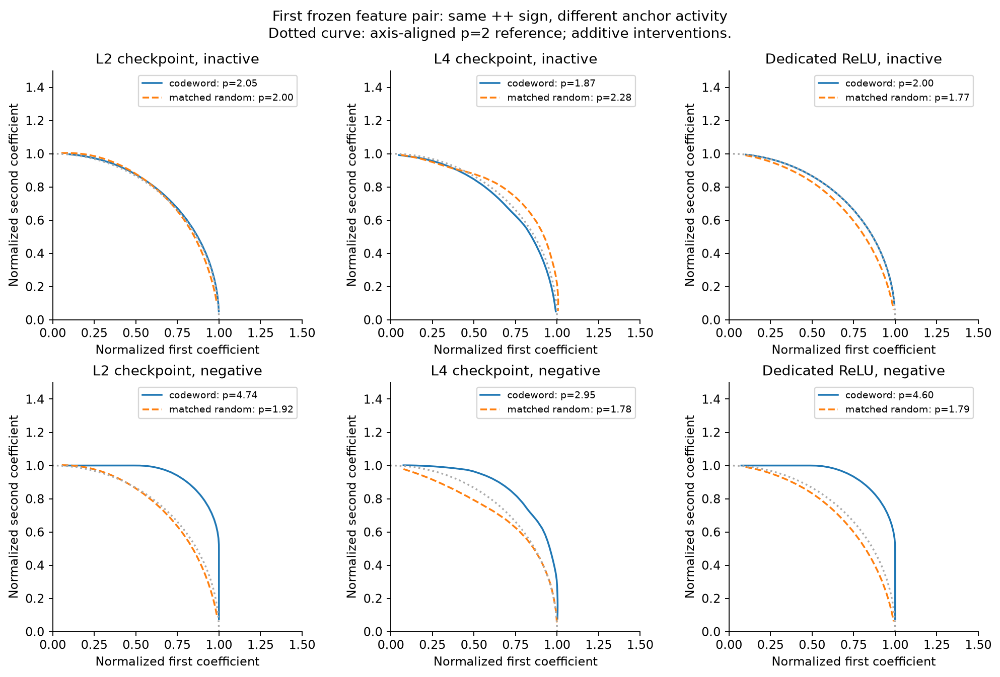
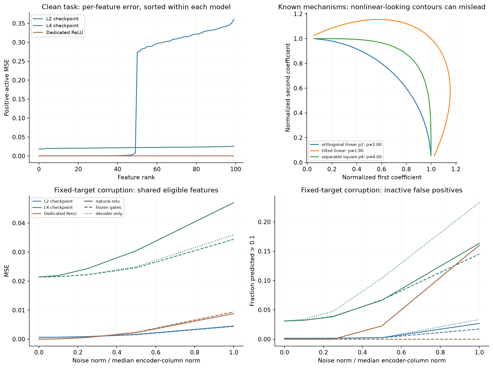

# Independent ReLU gates produce a strong high-p contour

**The scalar exponent does not identify learned CiS in this small assay.**
A dedicated-neuron ReLU control produces p=4.597 with a clean 0.425% mean radial
fit residual. The learned L4 checkpoint has no consistent higher-p separation
from the L2 checkpoint or matched random directions across the frozen settings.
This is a specificity result for this measurement, not a refutation of the FSEC
paper or evidence that the learned checkpoint lacks computation in superposition.

## The models pass the intended behavioral check

We loaded the released [100→50 L2 and L4 checkpoints](https://github.com/FranciscoHS/toy-model-cis-code/tree/8c827b8c07bcf39097ee21707c62641a9201a216/weights)
and added an exact 100→100 identity-encoder/decoder ReLU control. No training.
Fresh sparse signed inputs have target ReLU(x).

| Model | Eligible single-feature probes | Positive-active MSE, all 100 features | Inactive RMSE |
|---|---:|---:|---:|
| L2 checkpoint | 50/100 | 0.15857 | 0.01036 |
| L4 checkpoint | 100/100 | 0.02208 | 0.04685 |
| Dedicated ReLU | 100/100 | 0 | 0 |

Eligibility uses self-gain ≥0.25 and correct output argmax. Every feature's gain,
error and eligibility is retained. The L4 encoder has 58 size-5, 38 size-6 and
four size-7 thresholded codewords; its decoder/pseudoinverse cosine is 0.99615.
Those checks support the released mechanism characterization. L2 represents
fewer features accurately and has less inactive leakage; checkpoint labels are
not proofs of the presence or absence of every form of CiS.

## Ordinary gates can generate the apparently privileged boundary

Six feature pairs were frozen from the common eligible set before measuring p.
We perturb their actual encoder columns additively before ReLU, preserving
column overlap. Random controls match both norms and mutual cosine. There are
four sparse backgrounds, three pair-input states, and all four sign quadrants.

This readable slice fixes both perturbation signs positive. Each entry is the
median fitted p over the **same six pairs** at the primary threshold:

| Both pair inputs | L2 codewords | L4 codewords | Dedicated feature axes |
|---|---:|---:|---:|
| 0 (absent) | 2.035 | 1.826 | 1.999 |
| +0.5 | 2.016 | 1.934 | 1.999 |
| −0.5 | **4.698** | **3.083** | **4.597** |

All entries in this slice have mean radial fit residuals below 2%. In the
negative-input row, matched-random medians are 1.825, 1.792 and 1.862. Thus even
a feature-versus-random high-p separation can appear without shared neurons.

For the dedicated control in that condition, the response is exactly

\[
R(a,b)=\sqrt{\max(a-0.5,0)^2+\max(b-0.5,0)^2}.
\]

Each gate remains closed until its own input crosses zero. Their two independent
flat regions create the boxier contour. No compressed representation or learned
denoising objective is involved. Threshold fractions 0.25/0.5/0.75 give p values
7.175/4.597/3.736, all with residuals below 0.51%. The exponent is visibly a
property of the anchor and measurement threshold, not just the feature pair.
Thresholding can itself reject noise; we are not claiming every possible notion
of error correction is absent from this control.

The plot uses the **first frozen pair**, not a best-performing example. Values
in the table aggregate all six. [All signs and finite fits](geometry.png) remain
available: 432 primary surfaces, 396 finite primary fits, 36 flat-axis cases and
95 flagged finite fits. Many mixed-sign curves are poorly described by one
superellipse. Flat cases are recorded as ineligible; no ignored or flat feature
is silently assigned p=2. The full all-sign medians should be read alongside
these eligibility and residual flags, not as intrinsic model constants.

## The simpler geometric explanations are checked

The analytic controls recover p=1.99983 for an orthogonal linear map and
p=4.00026 for the separable square map. A tilted linear response is extremely
well described by a quadratic with a cross term; an axis-aligned superellipse
can fit it badly. We retain that poor fit instead of calling its exponent a
nonlinear signature.

All 144 after-ReLU decoder-only controls agree with their exact quadratic
response formula to 2.3e−15 absolute error. The contour-fitted quadratic's
maximum mean radial residual is 0.0064%. In contrast, the dedicated negative-input
ReLU example is better fit by its superellipse than by a tilted quadratic
(0.425% versus 2.270%): ruling out cross terms does not rule out ordinary gating.

The six prespecified 81×81 checks change p by at most 0.00213. Direct upstream
forward parity is exact; codeword/input intervention equivalence and random
Gram matching pass at floating-point precision. This is not a coarse-grid or
translation explanation for the main example.

## Geometry and fixed-target noise accuracy do not line up simply

Codeword additions change the feature signal itself. For a separate robustness
probe, we instead keep the clean target fixed and add Gaussian pre-ReLU noise.
We compare natural ReLU, frozen clean-input gates, and post-ReLU decoder-only
noise, all sharing the same clean output and noise realization.

At noise norm 0.5 times the median encoder-column norm, L4 gives:

| Gate treatment | Active MSE, common eligible features | Inactive fraction >0.1 |
|---|---:|---:|
| Natural ReLU | 0.03048 | 6.63% |
| Frozen clean gates | 0.02462 | 6.70% |
| Decoder-only noise | 0.02495 | 10.39% |

Natural gating reduces inactive false positives relative to decoder-only
injection while increasing active-feature error. Freezing clean gates improves
the latter. Neither is an unqualified recovery advantage. Frozen gates have
privileged access to the clean representation and are an ablation, not an
implementable competing denoiser. The models were not trained for this Gaussian
corruption task. This is not a direct causal test of learned cross-feature
interference cancellation.

## Scope and stopping point

This pilot uses one checkpoint per objective, six pairs selected for shared
eligibility, and four backgrounds. Dedicated neurons are an analytic control,
not an equal-capacity alternative to the 50-neuron bottleneck. We have not
retrained models, run Pythia/GPT-2, or generalized to all feature pairs or input
activity patterns. The previously reproduced baked-FSEC toy, p≈2.907, is a
separate procedural reference with a different model and intervention space.

The useful conclusion is concrete: **a high p, even with a clean fit and a
matched-random gap, can arise from independent task gates.** A test meant to
identify CiS or a correction mechanism needs evidence beyond that scalar.
The frozen pilot is complete and local; no new results were pushed remotely.

[Protocol](../../configs/toy-cis-v1.json) · [Methods and reproduction](METHODS.md) ·
[All fits and flags](analysis.json) · [Cohort CSV](cohorts.csv) ·
[Task checks and frozen pairs](prepared.json) · [Quality audit](quality-audit.json).
