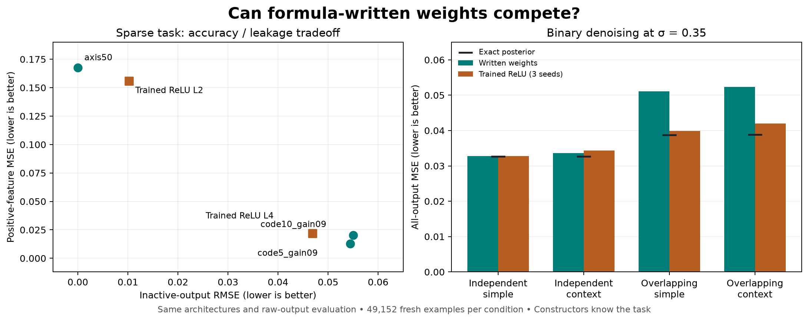

# Formula-written weights against trained toys

Eleven actual weight sets, zero gradient updates. Three fresh evaluation seeds, 16,384 examples each; raw outputs and the same inputs for every matched contestant.

The written independent-code denoisers are competitive with trained ReLU models. The shared sparse code improves positive-feature accuracy but pays for it in inactive leakage and overall loss. Trained networks clearly outperform the written decoders when denoising overlapping features.



## 100 → 50 → 100 sparse ReLU task

Positive MSE is the mean of per-feature positive-input MSEs, matching the existing evaluator. Coverage and error columns are means over evaluation seeds (and three training seeds for trained rows).

| Model | Coverage / 100 | Positive MSE | Inactive RMSE | Total MSE | Fourth-power loss |
|---|---:|---:|---:|---:|---:|
| axis50 | 50.0 | 0.167572 | 0.000000 | 0.001675 | 0.00100993 |
| code5_gain09 | 100.0 | 0.012763 | 0.054404 | 0.003062 | 0.00009072 |
| code10_gain09 | 100.0 | 0.020143 | 0.055005 | 0.003249 | 0.00009744 |
| trained ReLU L2 | 50.0 | 0.155832 | 0.010190 | 0.001656 | 0.00087695 |
| trained ReLU L4 | 100.0 | 0.021992 | 0.046850 | 0.002403 | 0.00003574 |

## 33 → 64 → 16 binary decoders

Each entry compares the constructed model with all three matching trained ReLU seeds. The exact posterior is a reference with unrestricted computation. Clean-trained models are shown on clean inputs; denoisers at their design noise σ=0.35. All models also get the full σ=0, 0.35, 0.6 sweep in metrics.json.

| Family / task | Written MSE | Trained ReLU MSE | Exact posterior MSE | Written active MSE | Trained active MSE |
|---|---:|---:|---:|---:|---:|
| orthogonal / linear_clean | 5.395644e-16 | 1.972993e-09 | 5.985841e-17 | 0.000000 | 0.000000 |
| orthogonal / linear_denoise | 0.03279439 | 0.03274286 | 0.03262088 | 0.167615 | 0.166249 |
| orthogonal / context_clean | 6.649773e-18 | 1.440959e-07 | 6.175573e-17 | 0.000000 | 0.000000 |
| orthogonal / context_denoise | 0.03361045 | 0.03437921 | 0.03267894 | 0.175924 | 0.177427 |
| coupled / linear_clean | 6.736955e-16 | 1.664132e-09 | 1.033267e-16 | 0.000000 | 0.000000 |
| coupled / linear_denoise | 0.05112465 | 0.03984945 | 0.03876052 | 0.277291 | 0.203649 |
| coupled / context_clean | 3.209238e-17 | 1.163539e-07 | 1.046085e-16 | 0.000000 | 0.000000 |
| coupled / context_denoise | 0.05234829 | 0.04193881 | 0.03880425 | 0.293872 | 0.216843 |

## How the weights are written

- **axis50:** identity encoder/decoder on the first 50 coordinates; exactly discards the other 50.
- **code5/code10:** fixed-seed positive binary columns with 5 or 10 entries per feature; a centered matrix pseudoinverse, scaled to isolated gain 0.9. This inverse acts on the constructed code, never on examples or trained weights.
- **Clean binary decoder:** known encoder dual, followed by a two-ReLU clamp. Context branches use the context input directly in the hidden weights. Four neurons per feature suffice to route either context. All 65,536 clean bit patterns in both contexts are checked.
- **Denoiser:** thresholds follow the known Bernoulli prior and Gaussian variance. Four ReLU hinges approximate the posterior sigmoid for simple tasks; two per context branch approximate it with a ramp. The overlap version uses marginal dual-coordinate variance and deliberately loses neighboring evidence.

## Scope and evidence

The constructor uses privileged task knowledge, especially the binary encoder. These are comparisons of resulting networks, not equally informed learning procedures. Both contestants use the same architecture, activation, output handling and evaluation samples.

The sparse-code family was explored on a separate 8,192-example development set (ones=5/10/15/25, gain=0.9). Sizes 5 and 10 were retained before these fresh seeds were evaluated; this is exploratory selection. See the protocol and pilot.json for every pilot result. Binary formulas were fixed without a pilot. No fresh-test-based changes were made.

All 30 bottleneck and 120 binary trained checkpoints are included in metrics.json. paired.json reports paired error differences against the mean error of the three matching trained ReLU models, with normal-approximation intervals over evaluation examples. These intervals do not describe training-seed or construction-seed uncertainty.

The Gaussian context gate can fail in extreme unbounded tails; it is exact on clean binary codewords, not on all real inputs. The noise sweep includes σ=0.6 as a stress test. Feature-boundary p is not measured in this task-performance experiment.

Weights: weights.safetensors. Construction: scripts/write_toy_weights.py. Evaluation: scripts/evaluate_written_toys.py. Checks: tests/test_written_toys.py. manifest.json records input, source, protocol and output hashes.

Reproduce into a new directory (Python 3.12, requirements/toy.txt):

```bash
python scripts/evaluate_written_toys.py --out work/handwritten-reproduction
python -m unittest discover -s tests -p test_written_toys.py
```
