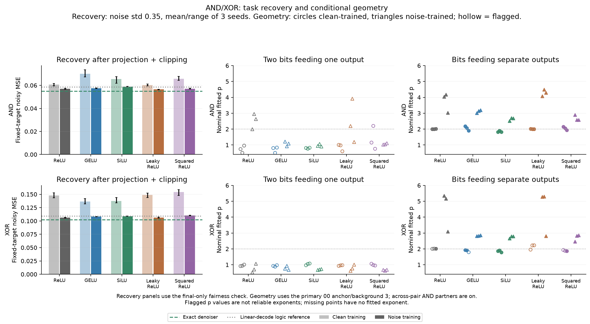
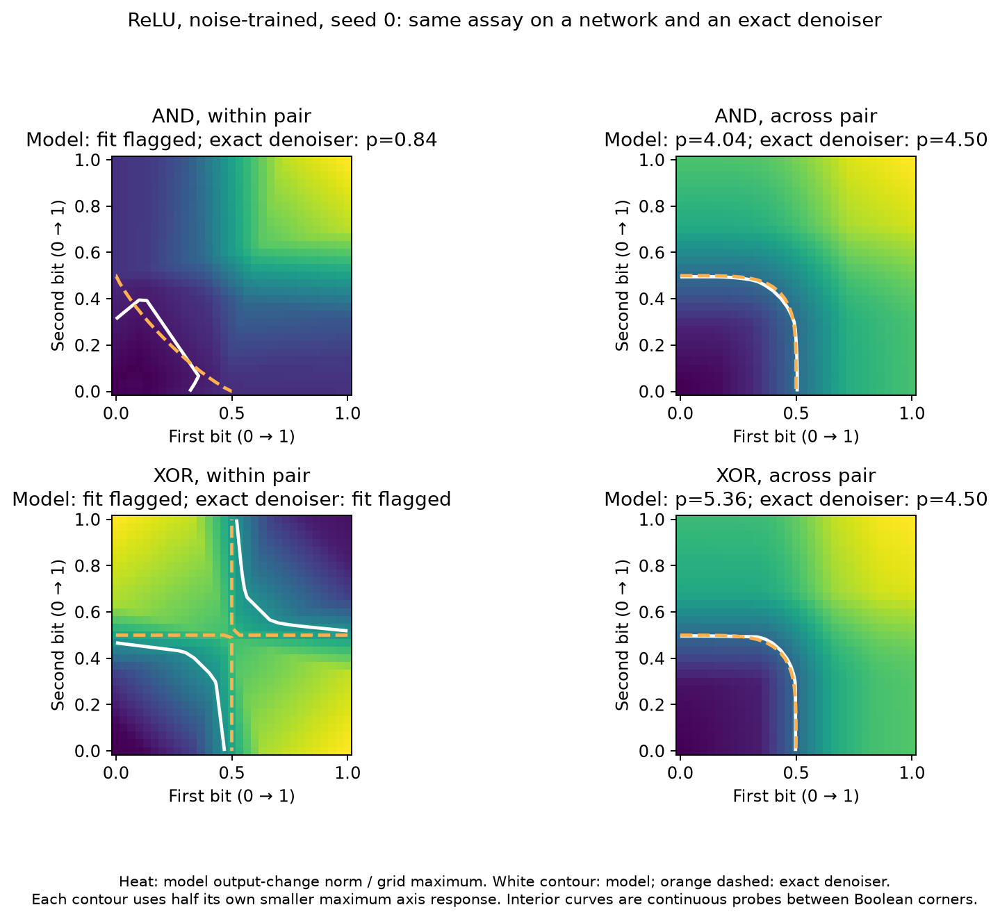

# AND/XOR: recovery and conditional geometry

**Noise training improves recovery and makes valid different-output contours
squarer. Probing two bits that feed the same logical answer gives a different
geometry: every learned primary fit is flagged, even when the task is learned
well. An exact AND denoiser can have p below 1.**

For AND, one switch alone may do nothing; both together change the answer. For
XOR, two flips can undo each other. A single monotone plateau is therefore an
assumption to check, rather than a shape every successful computation must have.

## Small experiment

We trained **60 fresh networks**: AND/XOR × clean/noisy training × ReLU, GELU,
SiLU, Leaky ReLU and squared ReLU × three initialization seeds. Each biased
32→64→8 network computes eight disjoint two-bit logical outputs from an
orthogonal encoding of 16 balanced input bits. Training ends at 30,000 updates;
0/5k/30k checkpoints give 180 frames. No weights were reused across functions.

All clean-trained networks achieve very small held-out clean error.
Noise-trained networks make softer predictions and tolerate corruption better.
Held-out targets always remain the original clean logical labels.

## Recovery: the controls matter

The table uses the final-only fairness check: give every model the known input
subspace, and clip predictions to [0,1]. Means span five activations and three
seeds, on 1,024 held-out examples and two noise draws at std 0.35.

| Task | Clean-trained MSE | Noise-trained MSE | Exact-denoiser MSE |
|---|---:|---:|---:|
| AND | 0.06445 | 0.05739 | 0.05501 |
| XOR | 0.14480 | 0.10793 | 0.10256 |

The known-code linear-decode/logic reference already reaches 0.05853 for AND
and 0.10947 for XOR. Noise-trained networks make a small additional improvement
over this informed reference. The much larger raw, unconstrained clean/noise
gaps—AND 0.217→0.0585, XOR 0.500→0.1105—partly reflect irrelevant observation
directions and predictions outside the target range. These controls do not
change any tested feature-plane geometry.

**AND's overall gain has a class tradeoff.** After projection/clipping,
positive-example MSE worsens from 0.1101 to 0.1272, while negative-example MSE
improves from 0.0491 to 0.0340. Class-balanced MSE slightly worsens,
0.0796→0.0806. AND positives occur only one quarter of the time. XOR improves
both classes. A squared-error denoiser optimizes total error under its prior;
that need not optimize each class separately.

## p: a conditional shape, not a recovery ranking

The primary geometry starts at 00. One probe changes bits feeding the same
output; the other changes bits feeding separate outputs, with their partners
on. Both choices were fixed before outcomes. Every other state/background is
also retained.

For noise-trained networks, **all 30 different-output fits pass** the declared
checks. Clean-trained AND fits are near p=2; 7/15 clean-trained XOR fits pass,
also near 2. Noise training moves the valid different-output p upward:

| Activation | AND p | AND MSE | XOR p | XOR MSE |
|---|---:|---:|---:|---:|
| ReLU | 3.75 | 0.05696 | 4.54 | 0.10615 |
| GELU | 3.12 | 0.05750 | 2.84 | 0.10810 |
| SiLU | 2.63 | 0.05897 | 2.75 | 0.10892 |
| Leaky ReLU | 4.29 | 0.05647 | 4.46 | 0.10624 |
| Squared ReLU | 2.69 | 0.05703 | 2.72 | 0.11027 |

Each cell averages three seeds; MSE is projected/clipped as above. All p fits
in this table are unflagged. Activation-dependent p differences are much larger
than the recovery differences. Squaring ReLU does not force a larger exponent.

For the **same-output** probe, all 60 final learned-model primary fits are
flagged. Their finite nominal exponents remain in the raw results and are shown
hollow in the plot; they are not promoted as reliable p measurements.

The exact posterior denoiser clarifies the structural issue. Its AND
same-output fit is unflagged at **p≈0.836**, versus **p≈4.504** across outputs.
Refining to 121×121 gives approximately 0.837 and 4.520. The weak AND single-axis
response is only 1.66% of the full joint response, so the relative-axis threshold
selects a very small output-change contour. Learned approximation errors can
matter greatly on that slice. For XOR, the exact same-output contour has
cancellation/multiple-region flags too; a finite fitted number is not an
adequate summary.

These directions represent underlying input bits, not independently movable
logical output features. The result identifies a task/feature-choice limitation
of the assay; it is not a paper-compatible counterexample to the LLM experiment.

## Checks and scope

Boolean truth tables, independent-network gradients/Adam updates, exact
checkpoint resume and posterior enumeration over all 65,536 latent states pass.
Independent NumPy predictions agree with saved MPS predictions within 5.0e−6.
A separate Boolean-label/sum-count audit reconstructs recovery scores within
8.9e−16, and independently constructed final geometry agrees within 2.8e−15.

All 5,760 background fits are retained; 3,273 are flagged across states,
checkpoints and backgrounds. Of 160 learned-model fine-grid comparisons,
42 are jointly unflagged; their largest |Δp| is 0.0251. The oracle's low AND
exponent and XOR failures survive separate 61/121-grid checks.

This pilot uses three seeds, one encoder and two fixed probe pairs, with no
random-direction comparison or capacity sweep. Its 64 hidden units do not force
CiS. It supports using p to describe conditional response geometry alongside
actual recovery, class errors and fit diagnostics. It does not establish an
activation ranking or a scalar amount of error correction.

[Methods and reproduction](METHODS.md) · [Numerical tables](numerical-summary.md) ·
[Training curves](training-recovery.png) · [Network rows](networks.csv) ·
[Primary audit](quality-audit.json) · [Independent controls](projection-check.json)
