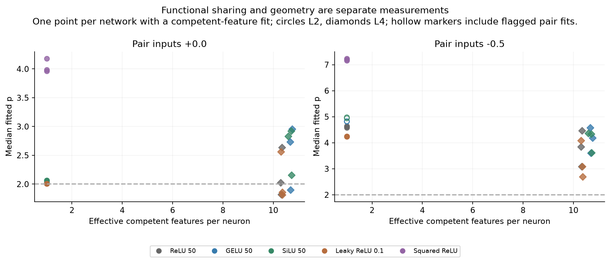

# Training activations separately: sharing and p can move independently

**Loss choice produces the clearest change in accurate shared computation;
activation curvature can produce a much larger change in p.** We trained every
activation's own weights for a full 100,000 updates. These are fresh training
experiments, not post-training activation swaps.

Five scalar activations, two losses and three initialization seeds give **30
completed networks**, each with 100 inputs/outputs, 50 hidden neurons and 10,000
weights. All use the same sparse ReLU(x) task, training pool, minibatch stream,
initial matrices and optimizer recipe. The source design follows the
[released CiS toy task](https://github.com/FranciscoHS/toy-model-cis-code/blob/8c827b8c07bcf39097ee21707c62641a9201a216/train_from_scratch.py).
SwiGLU was abandoned at the user's request and is excluded from this comparison.

## Do the activations learn more or less shared computation?

Under L2, **all five families compute 50 features accurately in every seed**,
with about one competent feature contributing per neuron. Under L4, ReLU,
GELU, SiLU and Leaky ReLU compute all 100 features, with similar functional
sharing. Squared ReLU has larger, relatively uniform errors under L4.

| Activation | Competent features, L2 / L4 | Effective features per neuron, L4 | Mean positive-active MSE, L4 |
|---|---:|---:|---:|
| ReLU | 50 / 100 | 10.32 | 0.02200 |
| GELU | 50 / 100 | 10.71 | 0.02363 |
| SiLU | 50 / 100 | 10.67 | 0.02440 |
| Leaky ReLU, slope 0.1 | 50 / 100 | 10.34 | 0.02229 |
| Squared ReLU | 50 / 0 qualify | — | 0.06350 |

Coverage counts agree across all three seeds. The sharing measure is contribution
participation among competent features; it is not a universal scalar amount of
CiS. Differences such as 10.71 versus 10.32 can reflect contribution structure
or cancellation and should not be called proportionally more CiS.

Competence requires positive-active MSE <0.05, unit-probe gain ≥0.25 and correct
output argmax. Squared ReLU's zero count under L4 means no feature meets that
criterion, not that nothing was learned or that all forms of CiS are absent.
[Full feature-error curves](feature-errors.png) and
[feature sharing versus error](feature-sharing-and-error.png) retain that
continuous information. L4's greater positive-feature coverage also comes
with more inactive leakage: inactive RMSE is about 0.047 for the four accurate
L4 families, versus 0.003–0.010 for their L2 models.

[Training and sharing trajectories](training-and-sharing.png) show this pattern
throughout the saved 10,000-step validation checkpoints. This fixed ReLU task
and one optimizer/initialization recipe do not establish a general activation
ranking or a grokking result.

## Do we get more p?

Yes, but it does not simply track more sharing. These entries average each
network's median over three task-competent pairs: absent pair inputs, ++
perturbations, primary per-pair threshold. Brackets give the range over three
initialization seeds, not a confidence interval.

| Activation | p, L2 | p, L4 [seed range] |
|---|---:|---:|
| ReLU | 2.010 | 2.162 [1.821, 2.639] |
| GELU | 2.019 | 2.530 [1.901, 2.957] |
| SiLU | 2.061 | 2.637 [2.154, 2.923] |
| Leaky ReLU | 2.006 | 2.078 [1.814, 2.561] |
| Squared ReLU | **4.044** | — no competent pairs |

Mean p is higher under L4 within each of the four accurate families, most
noticeably for GELU and SiLU. That is an association in this cohort. Their
sharing measures remain close to ReLU's, seed ranges overlap, and pair cohorts
matter: GELU L4's mean is 2.159 on the six fixed pairs, versus 2.530 on the
three competence-conditioned pairs. The four accurate L4 families use the same
three selected pairs; L2 and L4 can select different feature indices, so their
cohort means are not necessarily a comparison on matched pairs. The full
fixed/cohort/sign results are kept.

The clearest specificity counterexample is **squared ReLU under L2**. It remains
specialized—50 competent features, about one feature per neuron—yet has
p=4.044 [3.965, 4.182], versus matched-random p=2.151 [1.858, 2.548]. Its eligible
fixed-index subset also gives p≈3.800 (two networks have eligible fixed pairs).
Thus high p and a feature/random gap can occur without greater competent-feature
sharing. All 81 headline absent-anchor encoder fits are unflagged.

## Interpretation and checks

Squared ReLU is a deliberate curvature control. Its bias-free network is
homogeneous of degree two; ReLU(x) is degree one. On an isolated positive feature
ray, the best quadratic approximation has MSE 1/48≈0.02083. This helps explain
why its task fidelity needs separate treatment, but does not attribute the
entire L4 error gap to that bound. Its L2 features still satisfy the declared
competence criterion. Curvature can raise the contour exponent while neurons
remain specialized.

Encoder-column additions also equal changes to input feature values. Accurate
models of the same task can have similar feature contours despite different
internals. We therefore report functional sharing and geometric p separately;
we have not identified an error-correction stage or falsified the paper's LLM
measurements.

All **6,264 aggregate surfaces and 43,536,312 response points** are complete.
There are 95 invalid primary fits and 2,255 flagged finite fits across all signs,
activity states, direction families and task-ineligible probes; none are hidden.
The prespecified negative-anchor fine checks change encoder-direction p by at
most 0.00884. The largest change across controls is 0.0522, on an already flagged
random-direction fit. Some negative-axis GELU/SiLU fits are nonmonotone and are
shown hollow in the plots. [All geometry](geometry-comparison.png).

Training/provenance, independent-gradient, parameter-update, latent-intervention,
Gram-matching and artifact checks pass. Both training cohorts end with identical
minibatch RNG state after 100,000 draws and an identical dataset hash. Final
weights, competence-based pair selection and their hashes were committed before
measuring p (`bf23d98`). Training seeds vary initialization with data fixed;
random-direction controls have separate seeds. Uncertainty across datasets,
tasks, widths and optimized training recipes is untested.

The useful outcome is a learned counterexample to interpreting **larger p as
more CiS**, alongside a reproducible loss-driven change in competent sharing.
All requested training and measurement stages are complete. Checkpoints and raw
measurements are included with this report.

[Methods and reproduction](METHODS.md) · [Numerical summary](numerical-summary.md) ·
[Per-network CSV](models.csv) · [Full contour cohorts](analysis/cohorts.csv) ·
[Quality audit](quality-audit.json) · [Frozen protocol](../../configs/toy-scalar-comparison-v1.json).
